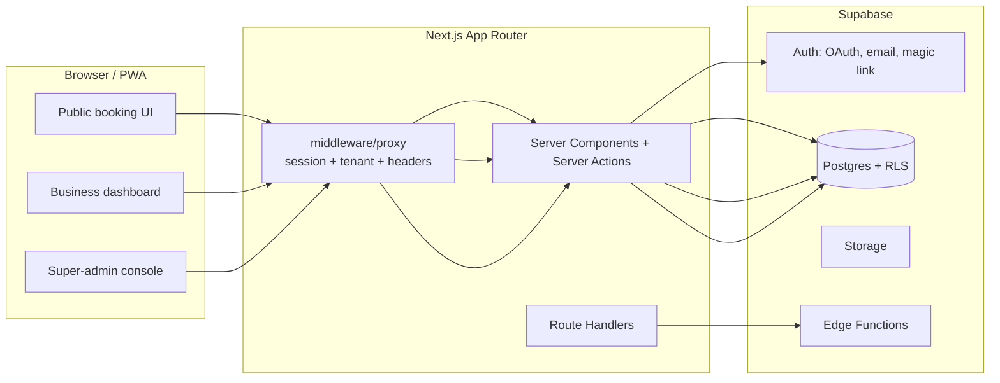
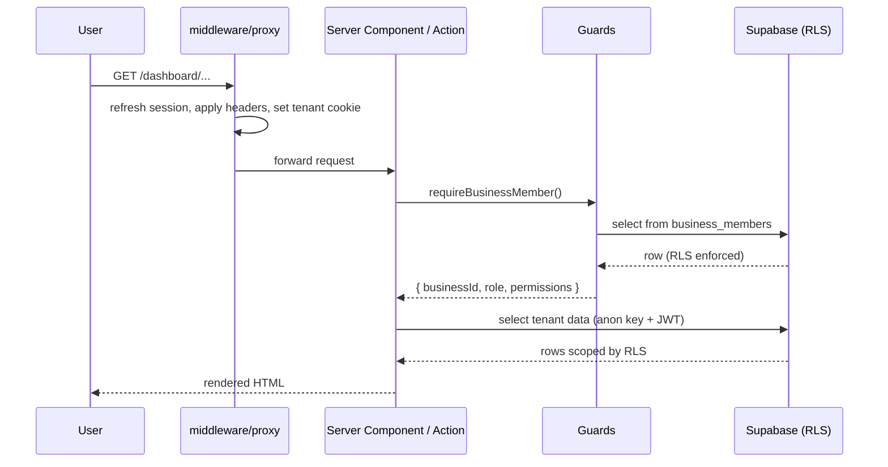

# Architecture

Concise reference for the multi-tenant appointment SaaS. For the full discussion and trade-offs, see the approved plan in [`.cursor/plans/`](../.cursor/plans/).

## 1. System overview



## 2. Tech stack

- Next.js 16 (App Router) + TypeScript
- Tailwind CSS v4 + shadcn/ui
- Supabase Auth, Postgres, RLS, Storage
- Data access: Supabase typed client (`postgrest-js`) with generated types — **not Prisma**, to keep RLS automatic via JWT forwarding
- Validation: Zod at every server boundary
- i18n: `next-intl` (Hebrew-first, RTL)
- Calendar: FullCalendar (MIT core) — admin only, post-Phase 1
- Tests: pgTAP for RLS, Vitest for app-layer units

## 3. Tenancy model

- **Shared Postgres, isolated by `business_id`** on every tenant-scoped table.
- Membership via `business_members` (`user_id ↔ business_id` with role + permissions). A user can belong to multiple businesses.
- Tenant context per request:
  - Public booking — derived from URL slug.
  - Authenticated dashboard — derived from active membership selected by cookie.
- Auth user never holds a `business_id`. The only platform-wide claim is `app_metadata.platform_role` for `super_admin` (server-set).

## 4. Roles and access

- Platform: `super_admin` (cross-tenant, set via JWT claim only).
- Per-business (rows in `business_members`):
  - `business_owner` — full control of the business
  - `business_admin` — full control minus billing + member management
  - `staff` — own calendar and customers

Authorization layers (defense in depth):

1. Supabase RLS — final gate.
2. Server guards (`requireSession`, `requireBusinessMember(role?)`, `requirePlatformAdmin`) — checked in Server Components and Server Actions.
3. UI affordance — hide controls the user cannot use (not relied on for security).

## 5. App layout

Route groups under [src/app/](../src/app/):

- `(marketing)/` — landing
- `(auth)/` — `/login`, `/callback`
- `(public)/[businessSlug]/...` — public booking (Phase 4+)
- `(dashboard)/dashboard/...` — business admin
- `(super-admin)/super-admin/...` — platform admin
- `api/` — webhooks, health

Server code under [src/server/](../src/server/):

- `actions/` — Server Actions per domain (validate → guard → execute → audit)
- `services/` — pure domain logic (testable)
- `repositories/` — typed Supabase query wrappers
- `guards/` — auth/permission helpers

Library code under [src/lib/](../src/lib/):

- `env/` — split client/server env validation
- `supabase/` — browser, server, admin, middleware clients
- `tenant/` — request-scoped tenant resolution
- `security/` — headers + policy registry
- `i18n/`, `branding/`, `utils/` (added per phase)

## 6. Booking engine (planning reference)

Slots are **computed on demand** from `availability_rules` + `availability_exceptions` + active `appointments`.

The override table is named `slot_overrides` (not `available_slots`) to prevent any future drift back to "all future slots" materialization. `slot_overrides` persists **only** manual one-off slots, manual blocks, or admin-created exceptions on top of the rule set. It is never populated by a generator.

Race safety on booking (Phase 4):

- `pg_advisory_xact_lock` on `(business_id, staff_id, start_at)` inside a `SECURITY DEFINER` function.
- GiST `EXCLUDE` constraint on `appointments` for staff-bound bookings.
- Capacity counter check under the same lock for `service.capacity > 1`.
- Rate limiting (per IP + per phone hash) is **part of the initial booking implementation in Phase 4**, not a later hardening step.

Not implemented in Phase 1.

## 6a. SECURITY DEFINER function rules

Every `SECURITY DEFINER` function in this project must:

1. Set an explicit, restricted `search_path`: `set search_path = pg_catalog, public` (or stricter — never the user default).
2. Run input validation at the top of the function before any side effects (slug format, UUID format, status enum, length caps).
3. Never accept a `business_id` from the caller without proving the caller's right to act on that business (membership check or anon-flow constraint).
4. Be `revoke execute ... from public` then `grant execute ... to <named role>` so only the intended callers reach it.
5. Be paired with a pgTAP test that asserts unauthorized inputs are rejected.

Phase 1 introduces no `SECURITY DEFINER` functions of its own — these rules govern Phase 4's `public.book_appointment(...)` and any future helpers.

## 6b. Reserved business slugs

`businesses.slug` is globally unique. A reserved-word list (enforced by a `CHECK` constraint + duplicate `business_members.is_reserved_slug()` helper in app code) blocks slugs that would collide with platform routes or look like a brand domain. The list, kept in [`src/lib/tenant/reserved-slugs.ts`](../src/lib/tenant/reserved-slugs.ts) and mirrored as a SQL constant array:

```
api, app, admin, super-admin, dashboard, login, logout, signup, signin, auth,
callback, billing, pricing, terms, privacy, support, help, docs, blog,
status, health, www, public, static, assets, images, img, files, cdn, mail,
email, sms, webhooks, webhook, internal, system, settings, account, accounts,
me, my, user, users, business, businesses, customer, customers, staff,
service, services, book, booking, bookings, appointment, appointments
```

Format: lowercase letters, digits, single hyphens, length 2–64, no leading/trailing hyphen. Implemented as a SQL `CHECK` plus a `before insert/update` trigger that lowercases and validates against the reserved list.

## 7. Data flow — authenticated dashboard request



## 8. Server Action pipeline

Every mutation follows the same shape:

1. `requireSession()` (or `requireBusinessMember(role?)` / `requirePlatformAdmin()`).
2. Zod `safeParse` of input — reject unknown fields.
3. Business-rule checks.
4. Repository call (Supabase client) — RLS applies.
5. `recordAuditEvent()` for sensitive mutations.
6. Return minimal typed result. Never echo secrets or full records to the client.

## 9. Environment

- Public: `NEXT_PUBLIC_APP_URL`, `NEXT_PUBLIC_SUPABASE_URL`, `NEXT_PUBLIC_SUPABASE_ANON_KEY`, locale and root domain.
- Server-only: `SUPABASE_SERVICE_ROLE_KEY`, `AUTH_SECRET`.
- Server-only modules import `server-only` to prevent accidental client bundling.

## 10. Out of scope for Phase 1

Booking UI, slot engine, FullCalendar, notifications, payments, super-admin console (beyond placeholders), white-label CSS injection beyond stored fields, i18n routing.

Each item maps to a later phase in the approved roadmap.
